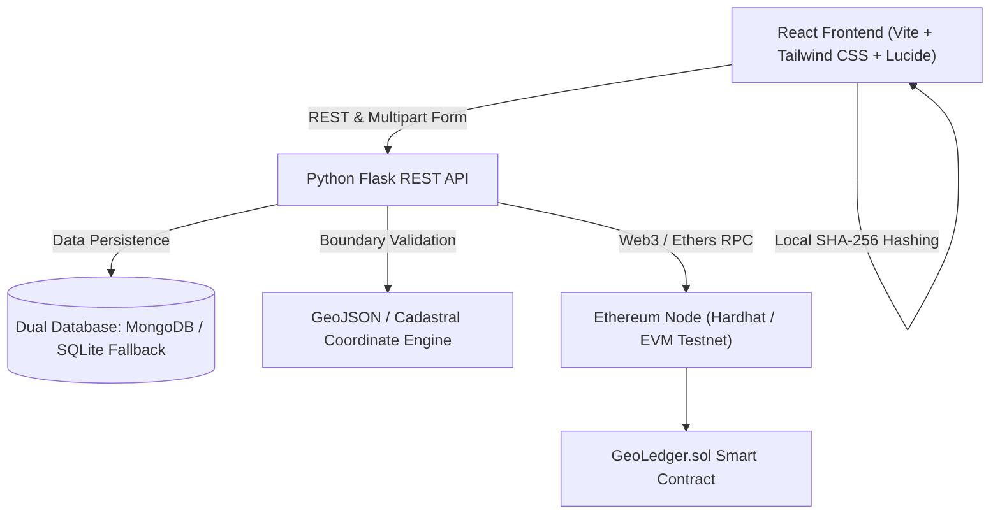

# 🌍 GeoLedger

> **Decentralized Geospatial Cadastral Registry & Blockchain Land Title Verification System**

GeoLedger is an end-to-end decentralized land registry platform that marries **Geographic Information Systems (GIS)** with **Ethereum Smart Contracts** to provide tamper-proof, transparent, and verifiable property ownership, transfer workflows, and cryptographic document authentication.

---

## 🌟 Key Features

- **🗺️ Interactive GIS Cadastral Mapping**
  - Leaflet-powered geospatial visualization of land parcels with boundary polygons, surveyed coordinates, and cadastral overlays.
  - Interactive parcel selection with instant cadastral inspection and direct deed actions.
- **⛓️ Smart Contract Title Registry**
  - Ethereum / EVM-compatible smart contracts (`GeoLedger.sol`) recording immutable property registration and ownership transfers on-chain.
  - Transparent provenance tracking and cryptographic transaction receipts.
- **📄 Cryptographic Document Verification**
  - Client-side SHA-256 document hashing via the Web Crypto API (`crypto.subtle.digest`).
  - Documents are verified locally without exposing private file data to servers; hashes are matched against anchored ledger records.
- **🏛️ Workflow & State Machine Engine**
  - Structured multi-step registration wizard (Property Details, Boundary Coordinates, Owner Identity, and Legal Document Uploads).
  - Lifecycle state tracking: `SUBMITTED` ➔ `UNDER_REVIEW` ➔ `DOCUMENTS_PENDING` ➔ `VERIFIED` ➔ `APPROVED` ➔ `COMPLETED` (on-chain anchoring).
- **🔄 Frictionless Ownership Transfers**
  - Formal transfer proposals with counterparty verification, consideration records, and smart-contract execution.
- **📊 Real-time Dashboard & Activity Feed**
  - Live ledger statistics, recent transaction audits, registered property inventories, and notification feeds.

---

## 🏗️ Architecture & Technology Stack



| Layer | Technologies |
|---|---|
| **Frontend** | React 18, TypeScript, Vite, Tailwind CSS, Lucide Icons, Leaflet / React-Leaflet |
| **Backend** | Python 3.12+, Flask, Flask-CORS, PyMongo / SQLite fallback, Dotenv |
| **Blockchain** | Solidity `^0.8.20`, Hardhat, Ethers.js v6 |
| **Security** | Web Crypto SHA-256 local hashing, Role-based verification, Input Sanitization |

---

## 📂 Project Structure

```plaintext
GeoLedger/
├── backend/                    # Python Flask backend API
│   ├── app.py                  # Application factory and route registration
│   ├── config.py               # Environment configuration
│   ├── controllers/            # Request handlers (auth, doc, ownership, property, etc.)
│   ├── database/               # Database client (MongoDB + SQLite fallback + seed data)
│   ├── geojson/                # Cadastral parcel GeoJSON specifications
│   ├── models/                 # Data schemas (property, document, transaction, etc.)
│   ├── routes/                 # Blueprint endpoints
│   ├── services/               # Core business & blockchain bridge services
│   └── tests/                  # Backend unit & integration test suites
├── blockchain/                 # Hardhat blockchain workspace
│   ├── contracts/              # Solidity contracts (GeoLedger.sol)
│   ├── deploy-local.js         # Deployment script
│   ├── deployed-address.json   # Contract deployment artifact
│   └── hardhat.config.js       # Hardhat network configuration
└── frontend/                   # React + TypeScript frontend
    ├── src/
    │   ├── app/
    │   │   ├── components/
    │   │   │   ├── Layout.tsx      # Responsive shell with sidebar
    │   │   │   ├── Sidebar.tsx     # Navigation links & UI state
    │   │   │   └── screens/        # Core application views (Dashboard, Search, Register, etc.)
    │   │   └── App.tsx             # React Router routing configuration
    │   └── services/
    │       └── api.ts              # Axios client communicating with backend
    ├── package.json
    └── vite.config.ts
```

---

## 🚀 Quick Start Guide

### Prerequisites
- **Node.js** (v18.x or v20.x recommended) & **npm** / **pnpm**
- **Python** (v3.10+ recommended)
- **Git**

---

### 1. Smart Contract & Blockchain Setup

Navigate to the `blockchain` directory to install dependencies and run a local Ethereum node:

```bash
cd blockchain
npm install

# Start local Hardhat EVM node
npx hardhat node
```

In a second terminal, deploy the contract to your local node:

```bash
cd blockchain
npx hardhat run deploy-local.js --network localhost
```

---

### 2. Backend API Setup

Navigate to the `backend` directory, set up your Python virtual environment, and launch the Flask server:

```bash
cd backend

# Create and activate virtual environment
python -m venv venv
# On Windows:
venv\Scripts\activate
# On Linux/macOS:
source venv/bin/activate

# Install requirements
pip install -r requirements.txt

# Run the backend (defaults to SQLite fallback if MongoDB is not running)
python app.py
```
Before starting the API, create `backend/.env` with a generated `SECRET_KEY`, an
`ADMIN_EMAIL`, and an `ADMIN_PASSWORD` of at least 12 characters. Generate a
secret with `python -c "import secrets; print(secrets.token_hex(32))"`. The
development server will not start with the example/default secret.
> *The backend server will run on `http://localhost:5000` (or configured port).*

---

### 3. Frontend Setup

Navigate to the `frontend` directory, install packages, and start the development server:

```bash
cd frontend
npm install

# Run the Vite development server
npm run dev
```
> *Open your browser at `http://localhost:5173` to explore the GeoLedger portal.*

---

## 🧭 Land registration and ownership workflows

Sign in or create a user account, then link and verify a wallet from **Profile**.
The same wallet must be connected in MetaMask when submitting registration or
transfer applications.

- **New registration:** open **My Properties → Register New Land**, enter the
  parcel details, click the map to mark at least three boundary points, and
  upload the sale deed, ID proof, and mutation certificate. The drawn boundary
  is stored with the application and shown on GIS lookups, but is user-submitted
  and is not an authoritative cadastral survey.
- **Ownership transfer:** select an existing property, enter the new owner's
  name and wallet, then upload the sale deed, seller/buyer ID proofs, and
  mutation certificate.
- **Inheritance transfer:** identify the registered parcel and deceased owner,
  list the heirs, and upload the required inheritance documents.

An Admin reviews each application and its documents before approval. Approval
records the property/ownership change on the configured blockchain (or in
development simulation mode when no contract is configured).
Confirmed block metadata is also appended to
`backend/blockchain/blocks.jsonl` (one JSON record per transaction), including
the transaction hash, block number/hash, timestamp, transaction index, gas
used, chain ID, and whether the record came from simulation. The Transactions
screen shows these details. Simulation records do not have a real block hash,
gas receipt, or chain ID; they are clearly labeled as simulated.
When the backend starts, confirmed transactions already stored in the database
are backfilled into this log once. Older records are labeled as legacy when
their simulation source or receipt metadata was not saved at the time.
Application details include a status history with timestamps and the actor
responsible for each recorded transition. Existing records without history
continue to display their current status.

On upload, the backend validates the file extension and signature, stores a
server-computed SHA-256 hash, and performs best-effort text extraction and
field checks. This prototype does not automatically establish legal
authenticity: Admin review is required. Image OCR depends on optional
Pillow/pytesseract support and an installed Tesseract executable.

---

## 🔌 API Overview

| Method | Endpoint | Description |
|---|---|---|
| `GET` | `/properties` | List registered land parcels |
| `GET` | `/properties/<survey_number>` | Fetch a property record by survey number |
| `POST` | `/applications` | Submit a registration, transfer, or inheritance application |
| `GET` | `/applications/<application_id>` | Retrieve an application, current status, and status history |
| `POST` | `/documents/upload` | Upload supporting application documents |
| `POST` | `/applications/<application_id>/approve` | Admin approval and blockchain execution |
| `GET` | `/verify/property/<identifier>` | Public property and blockchain verification summary |
| `GET` | `/blockchain/transactions` | Query recorded blockchain transactions |

---

## 🔒 Security & Privacy

- **Document Integrity**: The backend computes SHA-256 hashes for uploaded files and checks them again when verifying or retrieving a document. Hashes detect later changes; they do not prove the original file is genuine.
- **Environment Isolation**: Database credentials, private keys, and session keys are secured in `.env` and kept strictly out of version control.
- **Cadastral Data**: GIS boundaries in this demo are synthetic or user-submitted and are not verified government records.

---

## 📄 License

This project is licensed under the [MIT License](LICENSE).
